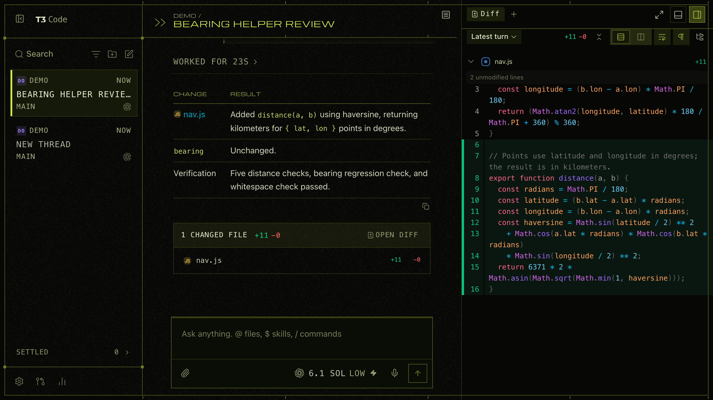
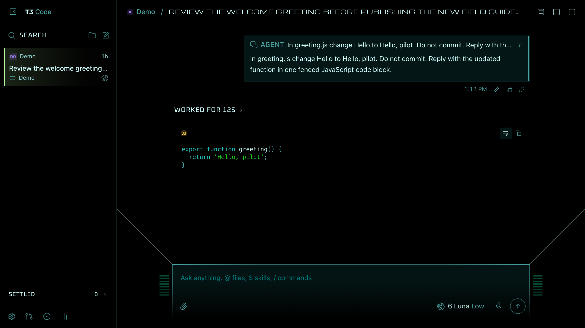

# T3 Code themes

Themes for [T3 Code](https://github.com/pingdotgg/t3code) that restyle the whole app, not just its colours: frames, labels, type and small working signals, each built from one reference image.

## Recon

Near-black space, dim olive hairlines and one acid yellow-green accent. While the agent works, a 2 px line sweeps along the composer's top edge.



More screenshots and details: [recon/](recon/README.md).

## Black Ice

Bare black, ice-white text and dim cyan lines, with an open frame around the composer. While the agent works, two stacks of emerald stripes beside the composer glow and scan.



More screenshots and details: [black-ice/](black-ice/README.md).

## Install

Checked on T3 Code 0.1.12, desktop app on macOS. Themes restyle the web and desktop apps, not mobile.

**Full install.** Copy the theme into T3's themes folder and switch to it. Recon also has a film-grain texture, `background.png`, which goes beside it:

```sh
git clone https://github.com/kusu-labs/t3-themes.git
mkdir -p ~/.t3/userdata/themes

# Recon
cp t3-themes/recon/theme.json ~/.t3/userdata/themes/recon.json
cp t3-themes/recon/background.png ~/.t3/userdata/themes/recon.png
~/.t3/bin/t3 theme set recon

# Black Ice
cp t3-themes/black-ice/theme.json ~/.t3/userdata/themes/black-ice.json
~/.t3/bin/t3 theme set black-ice
```

If you set a different T3 data folder (`T3CODE_HOME` or `--base-dir`), use its `userdata/themes` instead.

**Quick install.** In T3 Code, open Settings, Appearance, Add theme, and choose the theme's `theme.json` (or paste its contents). Black Ice installs completely this way. Recon works except for the grain.

**Undo.** Pick another theme in Settings, Appearance, or run `~/.t3/bin/t3 theme set t3-code`.

## Credits

- Recon: Michroma, by The Michroma Project Authors, under the SIL Open Font License 1.1 ([OFL.txt](recon/OFL.txt)). The theme embeds a subset.
- Black Ice: Oxanium, by The Oxanium Project Authors, and Michroma, by The Michroma Project Authors, both under the SIL Open Font License 1.1 ([OFL.txt](black-ice/OFL.txt)). The theme embeds a subset of each.

## Licence

The theme files are MIT ([LICENSE](LICENSE)). The embedded fonts stay under the OFL.
