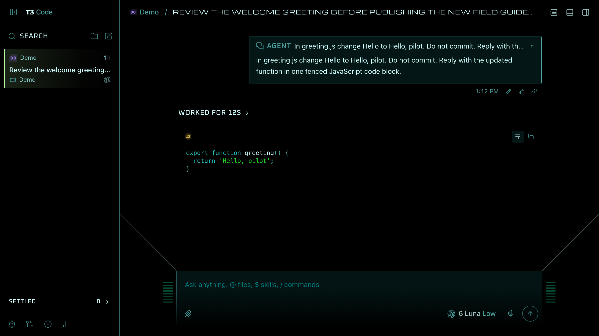
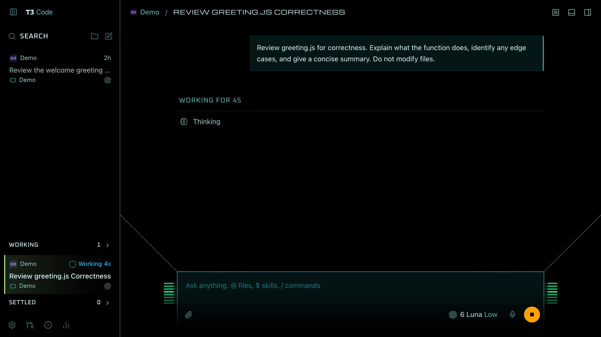
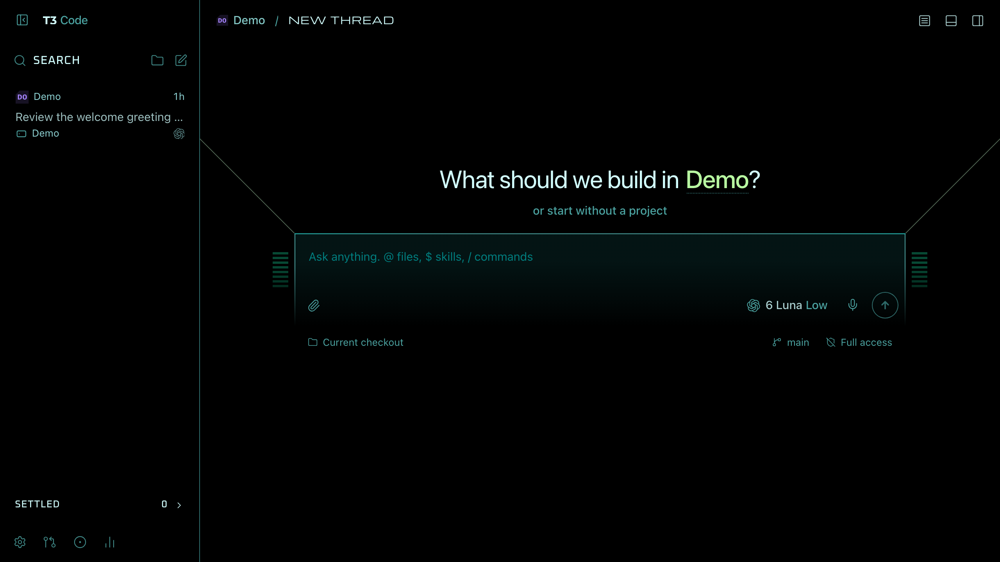
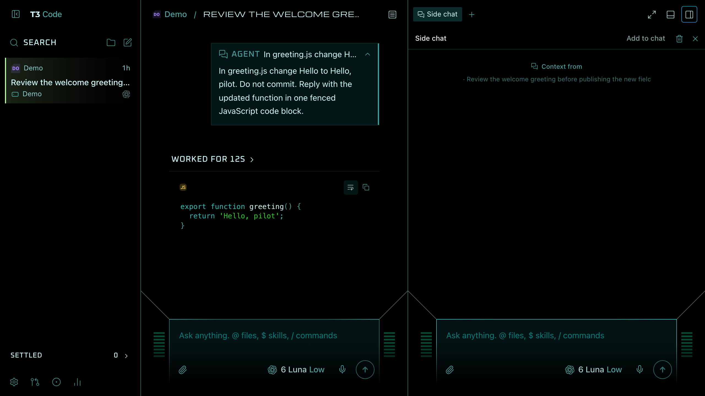
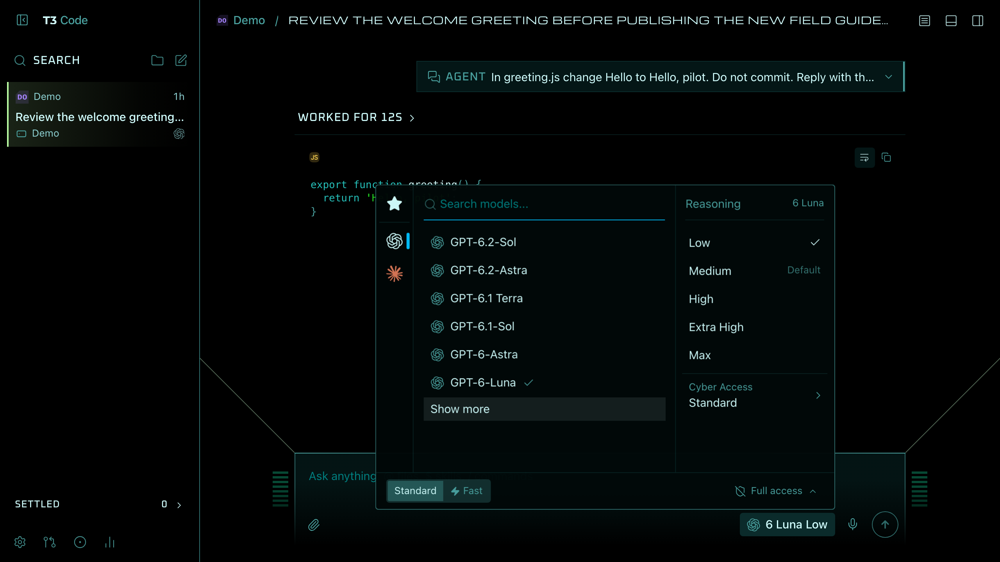

# Black Ice

A dark T3 Code theme: bare black ground, ice-white text, dim cyan lines and a few small instrument marks around the composer. Install steps are in the [main README](../README.md#install).

| | |
|---|---|
|  |  |
|  |  |
|  | |

## What it changes

- **Ground.** Every surface is black. Menus, popovers, dialogs and tooltips keep a 1 px dim cyan edge.
- **Composer.** An open frame: a thin cyan rail along the top, side walls that fade out downwards, no bottom line. Two dim green diagonals rise from its top corners, and their length follows the room beside the composer.
- **Working stripes.** A stack of eight emerald bars sits outside each side of the composer. While the agent works they glow and a bright bar scans down them. With reduced motion they stay lit without moving.
- **Send and Stop.** With text to send, the send button is an emerald disc in an emerald ring; hover turns the ring lime. Stop is an orange disc.
- **Sidebar.** The open thread gets a 2 px lime bar on its left edge with a soft lime fade.
- **Header.** The thread title is set in Michroma capitals.
- **Labels.** Search, sidebar group names, "Worked for" and menu group names use Oxanium capitals. Chat text and project names stay in the app's normal sans.
- **New thread.** The project name you can click is lime with a dotted underline.
- **Your messages.** A flat dark card with a hairline edge and a thin cyan bar down its right side.
- **Code.** Code blocks are recoloured to the cyan, white, green and lime palette.
- **Status colours.** Done is emerald, Working is blue, added lines lime, removed lines salmon.

## Limits

- Checked on T3 Code 0.1.12. It relies on some markup T3 doesn't promise to keep, so an update can break parts of it.
- The working stripes read the English label of the composer's stop button. In another language they stay dim.
- Primary, ghost and destructive buttons look the same apart from colour.
- The terminal, file tree and diff internals take the colours only.
- Long thread titles cut off sooner than in the default theme, because Michroma is wide.
- Under a 640 px window the stripes hide.
- Dark only. No background image.

## Credits

- Fonts: Oxanium, copyright 2019 The Oxanium Project Authors (https://github.com/sevmeyer/oxanium), and Michroma, copyright 2011 The Michroma Project Authors (https://github.com/googlefonts/Michroma-font), both under the SIL Open Font License 1.1 ([OFL.txt](OFL.txt)). The theme embeds a subset of each.
