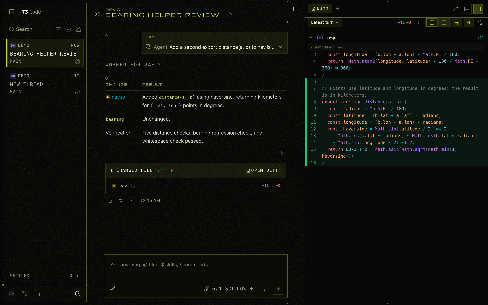
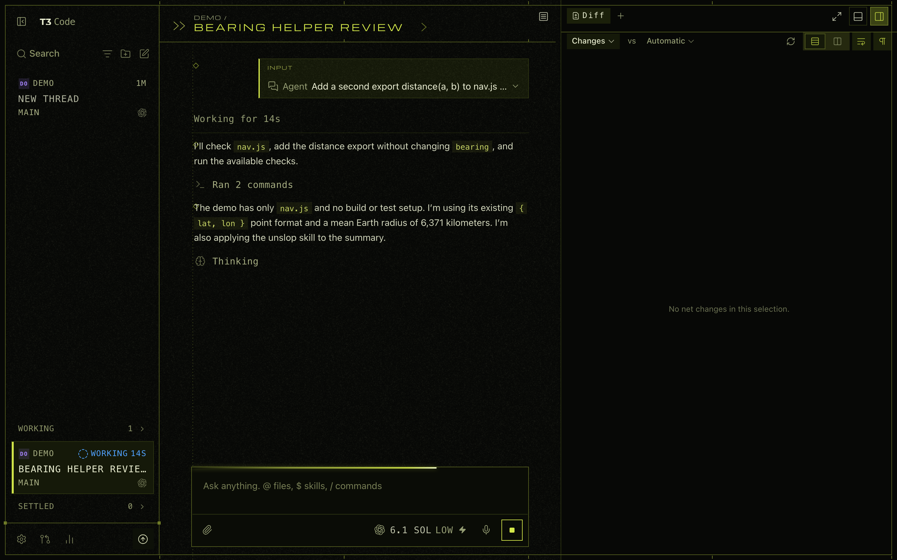
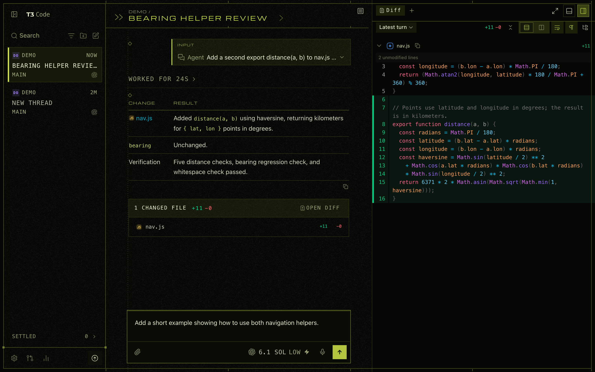
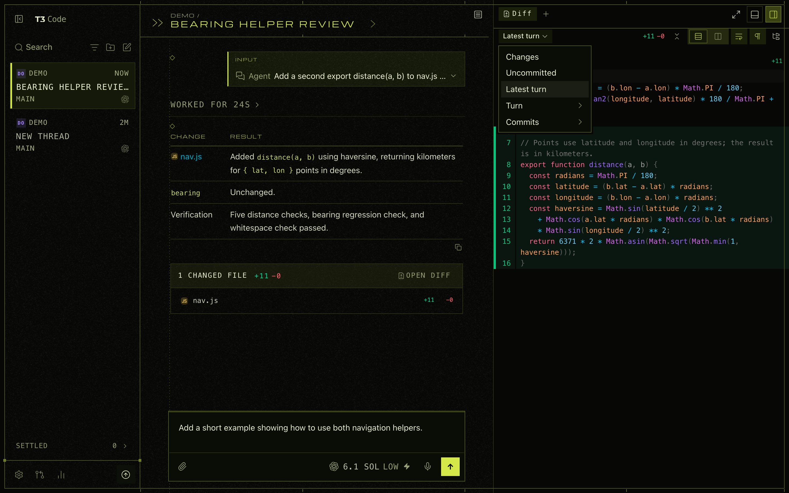
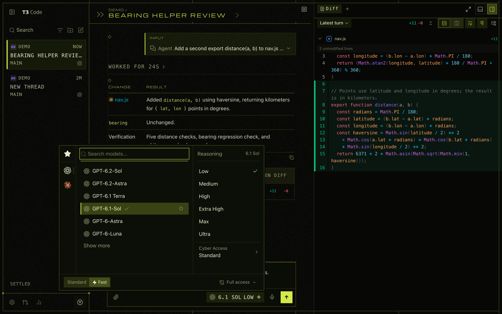

# Recon

A dark T3 Code theme of near-black space, dim olive hairlines and one acid yellow-green accent per area. Install steps are in the [main README](../README.md#install).

| | |
|---|---|
|  |  |
|  |  |
|  | |

## What it changes

- **Frame.** The sidebar and the main panel sit in hairline frames with small tick marks at 0, 25, 50 and 75 % and the right edge.
- **Header.** The project label sits above the thread title, which is set in Michroma capitals after a `>>` mark.
- **Working line.** A 2 px line runs along the composer's top edge. It sweeps from left to right while the agent works, and stays still if you turn on reduced motion.
- **Turn track.** A dotted line runs down the left of the chat, with a small diamond beside each message.
- **Labels.** Sidebar rows, buttons, menus and the thread details card use uppercase monospace. Chat text stays in the app's normal sans.
- **Code.** Code blocks are recoloured to the olive and acid palette.
- **Texture.** `background.png` is a film-grain tile made from random noise.

## Limits

- Checked on T3 Code 0.1.12. It relies on some markup T3 doesn't promise to keep, so an update can break parts of it.
- The working line reads the English label of the composer's stop button. In another language it stays dim.
- Primary, ghost and destructive buttons look the same.
- The terminal, file tree and diff internals take the colours only.
- Long thread titles cut off sooner than in the default theme, because Michroma is wide.

## Credits

- Font: Michroma, copyright 2011 The Michroma Project Authors (https://github.com/googlefonts/Michroma-font), SIL Open Font License 1.1 ([OFL.txt](OFL.txt)). Only capitals, digits and punctuation are embedded.
